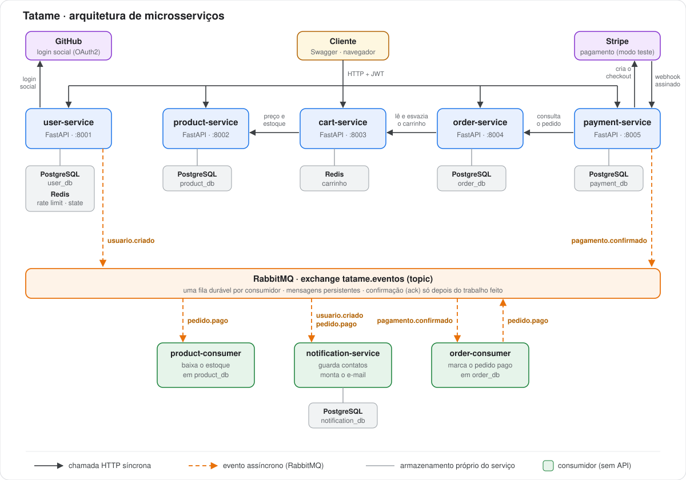

# Tatame

E-commerce de artigos de jiu-jitsu construído em **microsserviços** com Python e FastAPI. Cada serviço tem seu próprio armazenamento, os serviços conversam por HTTP quando precisam de uma resposta na hora e por **eventos no RabbitMQ** quando algo aconteceu e outros precisam reagir.


## Arquitetura



O sistema tem duas formas de comunicação:

- **HTTP síncrono (setas cinzas):** usado quando um serviço precisa de uma resposta para continuar. O carrinho pergunta preço e estoque ao catálogo, o pedido lê o carrinho e o pagamento confere o total do pedido.
- **Eventos assíncronos (setas laranjas):** usados quando algo já aconteceu e outros serviços precisam reagir. Quem publica não sabe quem vai ler, e um consumidor fora do ar não derruba quem publicou: o evento fica guardado na fila até ele voltar.

## Serviços

| Serviço | Porta | Armazenamento | Responsabilidade |
|---|---|---|---|
| `user-service` | 8001 | PostgreSQL + Redis | Cadastro, login com senha, login com GitHub, emissão do JWT |
| `product-service` | 8002 | PostgreSQL | Catálogo, com escrita restrita a administradores |
| `cart-service` | 8003 | Redis | Carrinho de cada usuário |
| `order-service` | 8004 | PostgreSQL | Pedidos, com preço e nome congelados no momento da compra |
| `payment-service` | 8005 | PostgreSQL | Checkout no Stripe e recebimento do webhook |
| `order-consumer` | — | PostgreSQL (o do pedido) | Marca o pedido como pago |
| `product-consumer` | — | PostgreSQL (o do catálogo) | Baixa o estoque |
| `notification-service` | — | PostgreSQL | Guarda contatos e monta o e-mail de confirmação |

## O caminho de uma compra

1. O cliente monta o carrinho. O `cart-service` confere preço e estoque no `product-service`.
2. `POST /pedidos` no `order-service` lê o carrinho, grava o pedido e os itens numa única transação e esvazia o carrinho.
3. `POST /pagamentos` no `payment-service` busca o total **no próprio pedido** (o valor nunca vem do cliente) e cria uma sessão de checkout no Stripe.
4. O cliente paga na página do Stripe, e o cartão nunca passa pelo Tatame.
5. O Stripe avisa o `payment-service` por um **webhook assinado**. A assinatura é conferida antes de qualquer coisa, e o pagamento é marcado como pago.
6. O `payment-service` publica `pagamento.confirmado`. O `order-consumer` marca o pedido como pago e publica `pedido.pago` com os itens.
7. O `product-consumer` baixa o estoque, e o `notification-service` monta o e-mail de confirmação.

## Decisões de arquitetura

- **JWT com RS256.** Só o `user-service` tem a chave privada e assina tokens. Os demais validam com a chave pública, sem chamar o `user-service` a cada requisição.
- **Um armazenamento por serviço.** Nenhum serviço lê o banco de outro. Os identificadores entre serviços (`usuario_id`, `produto_id`, `pedido_id`) são números soltos, sem chave estrangeira.
- **Cada serviço publica os eventos sobre os dados que são dele.** O pagamento não sabe quais itens foram comprados, então quem publica `pedido.pago` com os itens é o serviço de pedidos.
- **Consumidores idempotentes.** O RabbitMQ pode entregar o mesmo evento mais de uma vez. O pedido só muda de `pendente` para `pago` uma vez, e o catálogo guarda os pedidos já processados, com restrição de unicidade no banco, para nunca baixar o estoque em dobro.
- **Confirmação só depois do trabalho.** O consumidor confirma a mensagem (ack) depois de gravar no banco. Se cair no meio, a mensagem volta para a fila.
- **Contatos via eventos.** O `notification-service` não consulta o `user-service`: ele guarda o e-mail de cada usuário a partir do evento `usuario.criado`.
- **Rate limiting no login.** Cinco tentativas erradas para o mesmo e-mail bloqueiam novas tentativas por 15 minutos (resposta `429`), mesmo com a senha certa. A contagem fica no Redis.
- **Login social com GitHub (OAuth2).** O parâmetro `state` é guardado no Redis e vale uma única vez. O token do GitHub é usado só para identificar a pessoa, e o sistema emite o seu próprio JWT.

## Como rodar

Pré-requisitos: Docker e Docker Compose.

1. Crie um arquivo `.env` na raiz com as senhas dos bancos, do Redis e do RabbitMQ.
2. Crie `payment-service/.env` com a chave de teste do Stripe e `user-service/.env` com as credenciais do OAuth App do GitHub.
3. Gere o par de chaves RSA do JWT e coloque a chave pública em cada serviço que valida tokens.
4. Suba tudo:

```bash
docker compose up --build
```

A documentação de cada serviço fica em `http://localhost:<porta>/docs`, e o painel do RabbitMQ em `http://localhost:15672`. Para testar o webhook localmente, use a Stripe CLI:

```bash
stripe listen --events checkout.session.completed --forward-to localhost:8005/pagamentos/webhook
```

## Limitações conhecidas

- **Envio de e-mail simulado.** O `notification-service` monta a mensagem e a registra no log. O envio real por um provedor fica para uma próxima versão.
- **Stripe em modo de teste.** Nenhum valor real é cobrado.
- **Sem deploy público.** O projeto foi pensado para rodar com `docker compose up`.
- **Sem PKCE no OAuth2**, que a documentação do GitHub recomenda. E uma conta do GitHub não é ligada automaticamente a uma conta com senha que já exista com o mesmo e-mail, porque o cadastro não verifica e-mail (a resposta é `409`).
- **Logout sem invalidar o token.** O JWT vale até expirar.
- **Alterações de banco feitas à mão.** Um projeto maior usaria uma ferramenta de migração, como o Alembic.
- **A CI valida o build**, ou seja, o `docker-compose.yml` e a imagem de cada serviço. O projeto ainda não tem testes automatizados.
